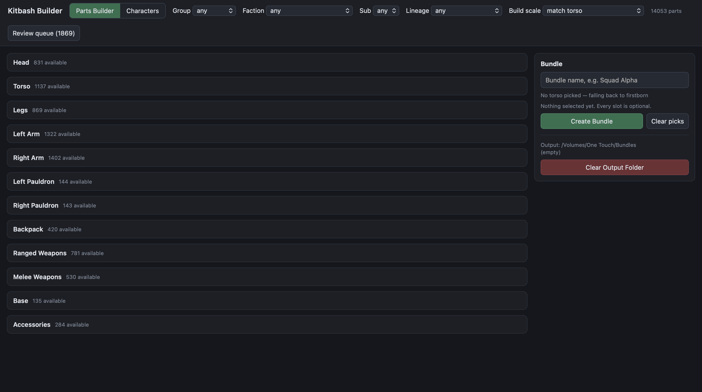

# Kitbash Builder

**Project write-up:** [sheetmars.github.io/projects/kitbash-builder](https://sheetmars.github.io/projects/kitbash-builder/)

A local parts library and kitbash builder for 3D-printable tabletop miniatures.

Point it at a folder of STL files and it works out what each file is (head, torso, arm, weapon, base…), which armour pattern or body type it belongs to, and how big it really is in millimetres. A browser interface then lets you mix and match parts from different kits, previews them in 3D, rescales them to fit one another, and exports the result as a named bundle of STLs ready for your slicer.

Everything runs on your own computer. Nothing is uploaded, and your model files are never modified.

**No model files are included.** This is a tool for organising a collection you already own.

## What it does

- **Indexes a library once.** A single pass reads every STL, measures it, and renders a thumbnail and a lightweight preview mesh. After that, everything works from a SQLite database, so reclassifying takes seconds and never touches the drive again.
- **Classifies parts by name and by size.** Rule-based keyword matching on file and folder names decides the part slot, the faction and the "lineage" (armour pattern or body type). Measured size checks the guesses: a 12 mm file is not a 32 mm figure, whatever its name says.
- **Corrects scale.** Sculptors export in wildly different units. Each pack gets one scale factor from its confidently identified parts, and parts from different lineages are rescaled to match the torso you build around, with warnings when proportions clash.
- **Handles messy downloads.** Supported and unsupported copies, pre-sliced printer plates, "Old" / "New Parts" revision folders, and image files saved with a `.stl` extension are all recognised. Exports keep one raw copy of each part.
- **Builds two ways.** The *Parts Builder* has twelve slots (head, torso, legs, arms, pauldrons, backpack, weapons, base, accessories) for mixing parts. The *Characters* view picks whole models and exports all their pieces at once.
- **Learns from your corrections.** A review workflow writes an Excel sheet per folder; your verdicts are imported back and override the rules on every later run.
- **Extracts archives safely.** `safe_extract.py` unpacks nested `.zip` / `.7z` / `.rar` / `.tar` downloads without running anything, blocking path traversal, symlinks, executable bits and archive bombs.



## Requirements

- Python 3.9 or newer
- `numpy` and `Pillow` (indexing and thumbnails)
- `openpyxl` (optional, only for the review spreadsheets)
- `libarchive` (only for `safe_extract.py`; preinstalled on macOS, `apt install libarchive13` on Debian/Ubuntu)

```bash
python3 -m pip install -r requirements.txt
```

Use `python3 -m pip` rather than plain `pip3`. On macOS they often point at different Python installs. `python3 kitbash.py doctor` shows which one is actually running.

## Quick start

```bash
# 1. Index your library (the first folder you index becomes the library root, and is remembered)
python3 kitbash.py index "/path/to/your/stls"

# 2. Open the GUI at http://localhost:8765
python3 kitbash.py serve
```

Indexing reads every mesh, so it takes a while on a large collection; on a laptop, keep the machine awake until it finishes. It can be stopped and re-run at any time: files already in the database are skipped.

To try it on a small sample first:

```bash
KB_LIMIT=200 python3 kitbash.py index "/path/to/your/stls"
```

### Folder layout

Faction is read from the first folder under the library root, so a layout like this works best:

```
stls/
├── Faction A/
│   ├── Infantry Squad/
│   └── Commander/
├── Faction B/
└── Terrain/
```

If your library is split across container folders (`stls/Drive A/Faction B/...`), the faction folder inside the container is used instead. If you have used different spellings for the same faction, map them to one name in `FACTION_ALIASES` near the top of `kitbash.py`.

## Configuration

No paths are hard-coded. Each one can be given as a flag on any command or as an environment variable, and the library, bundle and sheet locations are saved to `config.json` in the data folder after the first use.

| Flag | Environment variable | Default | What it is |
|---|---|---|---|
| `--library DIR` | `KB_LIBRARY` | *(set on first `index`)* | Root of your STL library |
| `--data-dir DIR` | `KB_DATA_DIR` | `~/.kitbash` | Database, thumbnails, preview meshes |
| `--bundles DIR` | `KB_BUNDLES` | `<data-dir>/bundles` | Where exported bundles are written |
| `--sheet FILE` | `KB_SHEET` | `<data-dir>/review.xlsx` | Review workbook |
| `--port N` | `KB_PORT` | `8765` | Port for the GUI |

Two more environment variables help with testing: `KB_LIMIT=N` indexes only the first N new files, and `KB_NO_RENDER=1` skips thumbnails and previews.

## Commands

| Command | What it does |
|---|---|
| `index [folder]` | Reads, measures and renders every STL (the slow, one-time step) |
| `classify` | Re-applies all rules from the database, keeping your manual tags |
| `serve` | Starts the GUI in your browser |
| `stats` | Summarises what the library contains |
| `make-sheet <folder> [name]` | Writes a review sheet for a folder, from filenames alone |
| `import-review` | Loads your verdicts from the review sheet |
| `content-check` | Scores the parts-vs-characters guess against your review notes |
| `dropdowns` | Restores the review sheet's dropdowns after Excel strips them |
| `rules [file]` | Writes a Markdown reference of every rule, generated from the code |
| `doctor` | Diagnoses Python and path problems |

See the [manual](docs/MANUAL.md) for the full workflow and how classification works. `python3 kitbash.py rules` writes a complete reference of every built-in lineage, keyword and threshold.

## Safe archive extraction

Model packs usually arrive as archives, often nested. Before indexing, unpack them with:

```bash
python3 safe_extract.py "/path/to/downloads"
```

Each archive is extracted into a new folder beside it; originals are never changed. Nothing extracted is ever run. See [docs/SAFE_EXTRACT.md](docs/SAFE_EXTRACT.md) for the safety guarantees and the report it writes.

## Limitations

- **Parts are scaled, not aligned.** Different sculptors use different origins and orientations, so pieces won't snap together. Position them in your slicer.
- **Rescaling breaks supports**, which is why exports prefer unsupported meshes. Add supports in your slicer after exporting.
- **The built-in keyword lists are tuned for 28 mm tabletop miniatures.** Other ranges and scales will still index, measure and export, but more parts will land in the review queue until you add keywords for them (see the manual).
- **Only STL files are read.** Binary and ASCII STL are both supported.
- The GUI binds to `127.0.0.1` only and is meant for one person on their own machine.

## About this project

I built this for my own hobby of 3D printing and painting miniatures, to sort a large collection of model files and make it easier to kitbash new models from it.

**AI use:** AI (Claude) wrote all of the code and the documentation. I did the planning and design.

Faction and unit names appear in the classifier only so it can recognise filenames. They belong to their respective owners, and this project is not affiliated with or endorsed by any miniatures company.

## License

[MIT](LICENSE)
